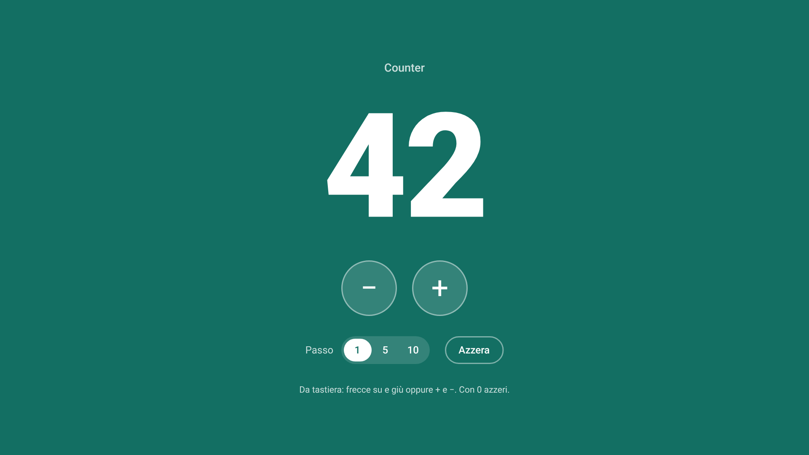
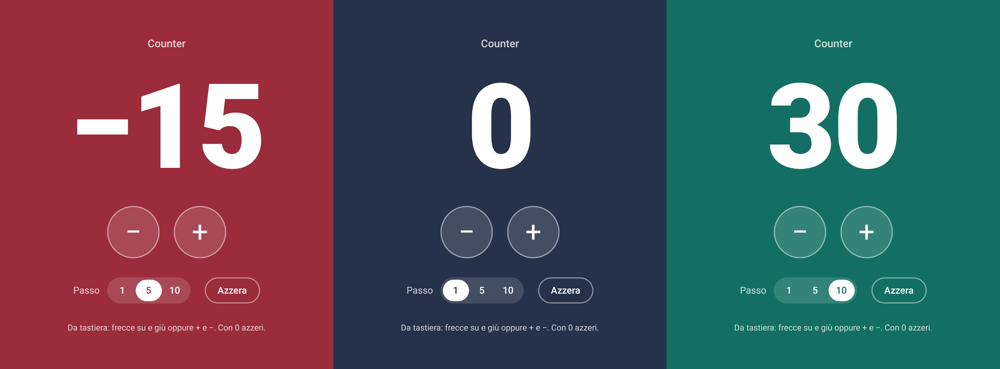

# Counter

Un contatore scritto in JavaScript puro, senza framework e senza librerie. Parte da 0 e sale o scende con i pulsanti + e −.

L'ho realizzato come progetto JavaScript del master start2impact.

## Prova l'applicazione

**https://umbywt.github.io/counter-js/**



## Cosa fa

Quando apri la pagina il valore è 0. Con + aumenta, con − diminuisce. Può scendere anche sotto zero: la consegna non lo vietava e un contatore che si ferma a 0 mi sembrava solo più limitato.

Alla richiesta di base ho aggiunto alcune cose:

- il pulsante Azzera riporta il valore a 0
- il passo si sceglie tra 1, 5 e 10, e ogni click sposta il valore di quella quantità
- valore e passo restano salvati nel browser con il localStorage, quindi li ritrovi anche dopo aver ricaricato la pagina
- si usa anche da tastiera: freccia su o `+` per aumentare, freccia giù o `-` per diminuire, `0` per azzerare
- lo sfondo cambia colore in base al segno del valore: blu a zero, verde sopra, rosso sotto



## Struttura del progetto

```
counter-js/
├── index.html
├── css/
│   └── style.css
├── js/
│   ├── main.js
│   ├── counter.js
│   ├── ui.js
│   └── storage.js
├── img/
│   ├── favicon.svg
│   ├── screenshot.png
│   └── stati.png
└── README.md
```

In `index.html` c'è solo un `<main id="app">` vuoto. Pulsanti, valore e tutto il resto dell'interfaccia li crea JavaScript con `document.createElement`.

Il codice è diviso in quattro file:

| File | Di cosa si occupa |
| --- | --- |
| `js/counter.js` | Tiene lo stato (valore e passo) e le funzioni che lo cambiano: `increment`, `decrement`, `reset`, `setStep`. Non tocca il DOM. |
| `js/ui.js` | Crea l'interfaccia con `buildInterface` e aggiorna quello che si vede con `renderValue` e `renderStep`. |
| `js/storage.js` | Legge e scrive lo stato nel localStorage. |
| `js/main.js` | Collega gli altri tre. A ogni azione cambia lo stato, lo salva e aggiorna la pagina. |

## Come provarlo in locale

I file JavaScript sono moduli ES (`import` ed `export`) e il browser li carica solo se la pagina arriva da un server. Se apri `index.html` con un doppio click la pagina resta vuota. Va bene un server locale qualsiasi, per esempio:

```bash
git clone https://github.com/UmbyWT/counter-js.git
cd counter-js
npx serve
```

In alternativa `python3 -m http.server` oppure l'estensione Live Server di VS Code.

## Qualche nota sulle scelte

Ho tenuto la logica separata dalla parte visiva. `counter.js` non sa nulla della pagina e `ui.js` non sa come si calcola il valore, quindi posso modificare uno dei due senza mettere mano all'altro.

Il valore sta dentro un elemento `<output>`, che gli screen reader leggono ogni volta che cambia. I pulsanti + e − hanno un'etichetta che dice anche di quanto si sposta il valore, per esempio "Aumenta di 5".

Quando le cifre aumentano il font si rimpicciolisce: JavaScript passa al CSS il numero di caratteri e il CSS calcola la dimensione. In questo modo il numero resta dentro lo schermo anche su telefono.

Non ho usato librerie esterne perché non servivano. L'unica risorsa caricata da fuori è il font Roboto, da Google Fonts.

## Autore

Umberto Brignone

- GitHub: [UmbyWT](https://github.com/UmbyWT)
- LinkedIn: [umberto-brignone](https://www.linkedin.com/in/umberto-brignone/)
